# ResearchVoice AI

**DEPI — Digital Egypt Pioneers Initiative**  
**Track:** AI Healthcare System  
**Project type:** Graduation project · Synthetic-data research prototype

> **Speak the data. Review the evidence. Export with confidence.**

ResearchVoice AI helps clinical researchers and study teams turn **spoken or typed research observations** into **structured, study-specific records**. The system checks extracted values against researcher-approved variables, flags missing or uncertain information, runs an independent AI quality review, and requires **human confirmation before Excel export**.

**Status:** Working n8n prototype demonstrated with synthetic cases. Not approved for real patient data or clinical decision-making.

## The problem

Clinical research data collection often involves moving between interviews or notes, paper case-report forms, and spreadsheets. Repetitive typing and rechecking can slow down documentation and introduce transcription errors or missing fields.

**Our goal:** Reduce repetitive data entry while keeping the researcher in control of every final record. Time savings, accuracy improvements, and financial impact are **targets for evaluation**, not yet validated outcomes.

## How it works

```mermaid
flowchart LR
    A[Researcher in Telegram] --> B[Study setup & approved schema]
    B --> C[Case / visit + voice or text]
    C --> D[Groq Whisper transcription<br/>when voice is used]
    D --> E[Researcher confirms transcript]
    C -->|Typed input| E
    E --> F[Gemini structured extraction]
    F --> G[Evidence & schema validation]
    G --> H[Independent Gemini QA judge]
    H --> I[Quality metrics & alerts]
    I --> J[LangSmith QA checkpoint]
    J --> K[Human review, corrections & approval]
    K --> L[Approved XLSX sent via Telegram]
```



The solution is **one integrated n8n workflow**, organized into five owned functional components under the team's instructor-approved arrangement—not five unrelated apps or a multi-agent framework.

## Five functional components

| Component | Responsibility |
|---|---|
| **1. Study & Schema** | Create studies; define and approve variable names, types, and units; manage cases and follow-up visits. |
| **2. Intake & Privacy** | Receive text or opted-in voice, transcribe speech, confirm transcripts, and apply best-effort identifier/instruction screening. |
| **3. Structured Extraction** | Use Gemini to map confirmed text to the approved schema, keep source evidence, and flag conflicts or missing values. |
| **4. Evaluation & Monitoring** | Independently score drafts on five QA dimensions; log LangSmith QA traces; report monitoring metrics and send alerts. |
| **5. Review & Export** | Allow researcher correction and approval, apply export holds where configured, generate XLSX, and deliver it in Telegram. |

## Key features

- **Researcher-defined studies:** Fixed schemas with variable data types and optional units.
- **Voice and text intake:** Telegram messages, with Groq Whisper transcription for voice.
- **Transcript confirmation:** Researchers verify captured text before AI extraction.
- **Evidence-grounded extraction:** Values are checked against schema fields and quoted transcript evidence.
- **Human-in-the-loop approval:** Missing, conflicting, and uncertain values require review; no silent export.
- **Independent LLM-as-judge:** Scores *factual accuracy, groundedness, safety compliance, format adherence,* and *bias* from **1–5**.
- **Monitoring and alerts:** `/eval` and `/monitor` summaries, soft warnings, and configured hard export holds.
- **Research-ready XLSX:** Approved variable-level data is returned to the researcher's Telegram chat.

## Technology stack

| Layer | Technology |
|---|---|
| User interface | **Telegram Bot** |
| Orchestration | **n8n** (single integrated workflow) |
| Speech-to-text | **Groq API**, Whisper Large v3 Turbo |
| Structured extraction | **Google Gemini** (`gemini-3.5-flash-lite` in the tested workflow) |
| Independent QA judge | **Google Gemini**, separate quality-evaluation call |
| Trace inspection | **LangSmith** (QA checkpoint traces) |
| Local runtime | **Docker / Docker Compose**, Ubuntu |
| Public webhook during demos | **Cloudflare Quick Tunnel** |
| Export | **XLSX / Excel** file delivered through Telegram |
| Prototype state | **n8n workflow static data**; no production database |

**Architecture note:** There is no custom React frontend, FastAPI backend, RAG system, or production database in the current workflow. LangSmith currently records **QA checkpoints**, not a full trace of every individual external model call.

## Getting started (local demonstration)

### Prerequisites

- Docker and Docker Compose
- An n8n instance reachable locally (example: `http://localhost:5678`)
- A Telegram bot token
- Groq API key
- Google Gemini API key
- LangSmith Personal Access Token with tracing API access
- `cloudflared` if using Telegram webhooks through a temporary public tunnel

### 1. Import the workflow

Import the **latest Phase 4 n8n JSON export** from the repository's `03_Build/` directory into n8n. Use a test copy initially, and **unpublish any older workflow using the same Telegram bot token** so the bot has only one active webhook consumer.

> Use the latest export from the running n8n instance in preference to an older import template if they differ.

### 2. Configure n8n credentials

Create or select the appropriate credentials for the Telegram nodes, Groq transcription node, Gemini extraction and judge nodes, and LangSmith trace-ingestion node.

The LangSmith credential uses an `x-api-key` header. The prototype was verified using a **Personal Access Token**; a workspace-scoped service key produced `403 Forbidden` during setup.

**Never commit API keys, bot tokens, credential exports, or secrets to GitHub.**

### 3. Start a demonstration webhook tunnel

```bash
cloudflared tunnel --url http://localhost:5678
```

In your existing Docker Compose configuration, set the environment values relevant to the public webhook and proxy:

```yaml
environment:
  - TZ=Africa/Cairo
  - GENERIC_TIMEZONE=Africa/Cairo
  - N8N_WEBHOOK_URL=https://YOUR-CURRENT-TUNNEL.trycloudflare.com/
  - N8N_PROXY_HOPS=1
  - N8N_EDITOR_BASE_URL=http://localhost:5678/
```

Retain your existing volume, port mapping, and other Docker configuration. Recreate the container only after validating the Compose file; **do not delete the persistent n8n volume**. Quick Tunnel URLs can change after restart and are **not production infrastructure**.

### 4. Run a synthetic example

1. Open the Telegram bot and send `/start` → create a new study.
2. Define variables such as **Age (integer, years)** and **HbA1c (decimal, percent)**; approve the schema.
3. Create a fictional case code (for example, `DEMO-001`) and enter an explicit visit date.
4. Send this **fictional** observation: `The patient is 54 years old and HbA1c is 6.2 percent.`
5. Confirm the transcript, inspect extracted values, and correct anything necessary.
6. Select **Confirm & Export** only after reviewing all fields.
7. Inspect the XLSX returned in Telegram. Use `/eval` and `/monitor` for QA summaries; view QA checkpoint traces in LangSmith.

For voice demos, send `/voiceon` **before** uploading a recording. The audio is transmitted to Telegram and then Groq **before** the content can be screened.

## Telegram commands

| Command | Purpose |
|---|---|
| `/start` | Start or open the main menu |
| `/new`, `/studies` | Create or select a study |
| `/case`, `/visit` | Start a case or a follow-up visit |
| `/voiceon`, `/voiceoff` | Enable or disable demo voice transcription |
| `/review` | Reopen the current record review |
| `/eval` | Show independent judge scores for the current visit |
| `/monitor` | Show rolling synthetic-demo monitoring metrics |
| `/redo` | Re-enter corrected case information and re-evaluate |
| `/recover`, `/retry` | Recover a review or retry interrupted document delivery |
| `/cancel`, `/help` | Cancel the current flow or show help |

## Quality evaluation and observed evidence

The independent judge rates five dimensions from **1 (poor)** to **5 (strong)**. The scores are **uncalibrated AI assessments**, not certified clinical accuracy, regulatory compliance, or clinician approval.

A documented synthetic voice test demonstrated:

- A speech-to-text mismatch involving the **HbA1c** variable was flagged rather than silently accepted.
- A **soft QA alert** prompted researcher review; the researcher corrected the value manually.
- The corrected visit was approved and delivered as an XLSX file in Telegram.
- The judge recorded **5/5 factual accuracy**, **5/5 groundedness**, **5/5 safety**, **3/5 format adherence**, and **5/5 bias/neutrality** (**4.6/5 average; needs review**).
- The `/monitor` command reported **one completed evaluation**, **one soft warning**, and **one confirmed Excel delivery** in that demo snapshot.
- LangSmith accepted the QA trace request and displayed a recorded run.

This is **one observed demonstration**, not a statistical benchmark. Human calibration by two independent reviewers, complete prescribed case records, and measured KPI actuals remain part of final project evaluation.

## Safety, privacy, and scope

> **ResearchVoice AI is an educational prototype for synthetic or properly de-identified test data only. Do not use real patient data.**

- **Assistive, not clinical:** No diagnosis, treatment selection, medication changes, or autonomous clinical decisions.
- **Human approval required:** Researchers review and explicitly approve values before export.
- **Best-effort safety filters:** Detect some identifiers, prompt-injection attempts, and out-of-scope clinical requests, but **cannot guarantee PHI removal or complete protection**.
- **External processing:** Telegram, Groq, Google Gemini, and LangSmith are separate services; never send sensitive data without appropriate authorization and governance.
- **Prototype persistence:** n8n workflow static data is not a secure, concurrent, durable clinical database.
- **Trace scope:** LangSmith stores intentionally limited QA metrics; full audit coverage and production observability are future work.
- **Security before real-world use:** Formal privacy review, identity/access controls, retention policies, secure durable storage, clinical validation, and deployment hardening would be required.

## DEPI project roadmap

| Checkpoint | Deliverable | Project state |
|---|---|---|
| **1. Business Discovery** | Business Brief, users, problem, KPIs | Draft documents prepared; baselines require validation |
| **2. Solution Design** | Component specifications, integration map, safety and monitoring plans | Draft documents prepared |
| **3. Build** | Connected n8n system, owner documents, individual tests | Integrated prototype running; individual evidence requires sign-off |
| **4. Integration & Testing** | Synthetic scenarios, LLM judge, LangSmith, monitoring, test report, backup video | Core demo verified; calibration, full evidence and video pending |
| **5. Business Pitch** | Slides and live demonstration | Presentation drafted; five-person rehearsal and approvals pending |

**Instructor-approved implementation arrangement:** Five functional components are owned by five team members within one connected n8n workflow. This is a documented exception to the generic five-separate-workflow structure in the course guideline.

## Repository guide

If the contents of the consolidated submission package are placed at the repository root:

```text
.
├── README.md
├── 00_START_HERE/         # Readiness tracker and manifest
├── 01_Business_Discovery/ # Business Brief and KPI workbook
├── 02_Solution_Design/    # Feature/spec cards, integration, safety
├── 03_Build/              # n8n export and five owner documents
├── 04_Evaluation/         # Scenarios, score sheets, dashboard, evidence
├── 05_Pitch/              # Presentation, speaking script, demo runbook
├── 06_Approvals_and_Signoff/
└── 07_Guideline_Reference/
```

**Note:** The consolidated submission contains draft documents and blank fields requiring actual team sign-off. Check `00_START_HERE/Master_Readiness_and_Signoff.xlsx` for remaining requirements. Avoid publishing files containing personal account IDs or confidential information.

## Team and acknowledgments

Developed as a **DEPI — Digital Egypt Pioneers Initiative, AI Healthcare System** graduation project by a five-member team. Component owners and presentation roles should be entered after team confirmation.

---

**ResearchVoice AI · Synthetic data only · AI assists, the researcher decides.**
